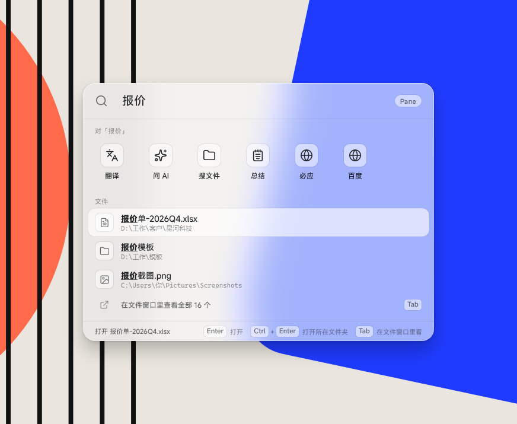
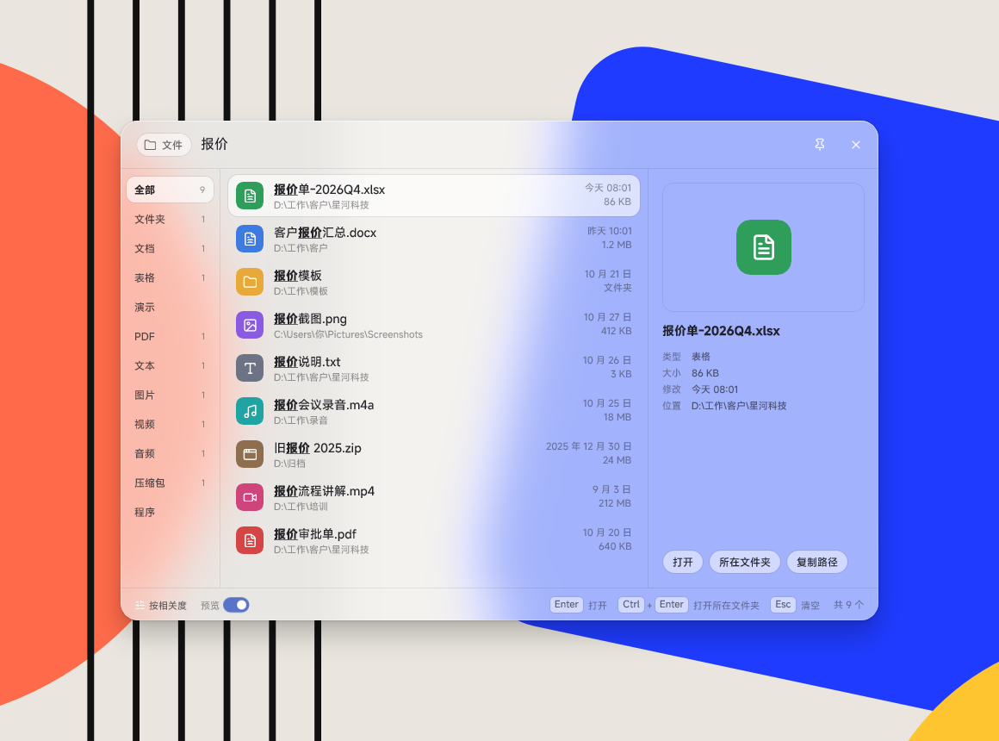
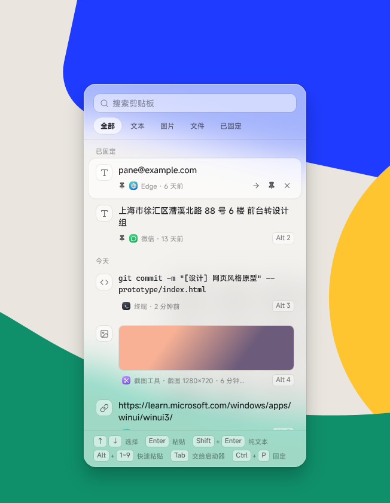
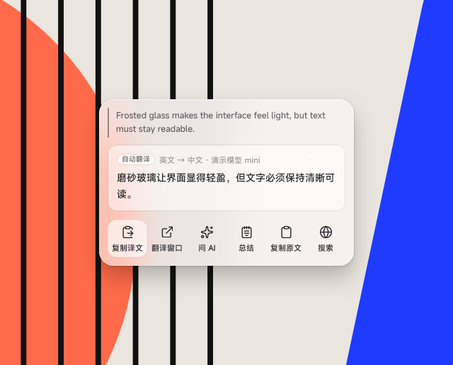
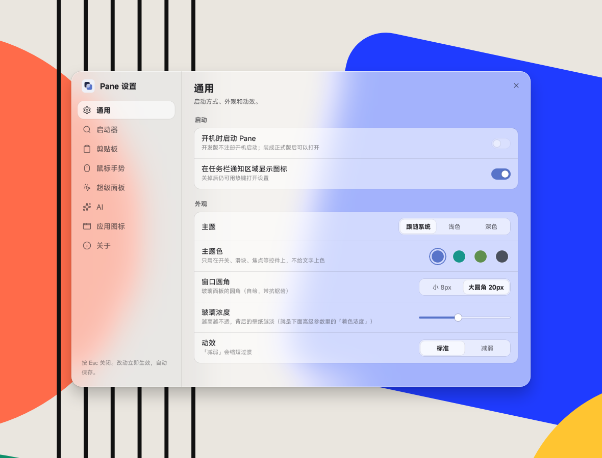

# Pane

Windows 上的启动器、鼠标手势和剪贴板工具，磨砂玻璃风格。一个常驻的小程序，替代「快速启动 / 搜索」「鼠标手势」「剪贴板历史」这几类工具。

> 平台：Windows 11（x64）。界面和文档目前只有中文。

<p align="center">
<picture>
  <source media="(prefers-color-scheme: dark)" srcset="docs/images/launcher-dark.png">
  
</picture>
</p>

## 功能

**启动器**（默认 `Alt+空格`）

- 搜应用（支持拼音和首字母，`wx` → 微信）、算式、系统命令（锁屏、睡眠、关机……）、常用文件和文件夹。
- 应用和动作排成格子，文件排成列表；底部一行写明选中项按 Enter / Tab / Ctrl+Enter 各做什么。
- 输入任何文字都有一排动作：翻译、问 AI、搜文件、AI 预设动作、网页搜索；按住 Alt 显示序号，Alt+数字直接触发。顺序和显隐在设置里调。
- 复制后几秒内呼出，刚复制的内容自动作为附件带进来（不清空剪贴板）。

**三个窗口**（从启动器按 Tab 展开，失去焦点不关）

<picture>
  <source media="(prefers-color-scheme: dark)" srcset="docs/images/files-dark.png">
  
</picture>

- 文件：Everything 驱动的文件搜索，按类型分类、按修改时间排序、预览、拖出文件。
- 翻译：边打边翻，中文自动译成英文，其余译成你设定的语言。
- AI 对话：多轮对话，可换模型；只保留到关掉窗口为止。

**剪贴板**（默认 `Alt+V`，可以替换系统的 `Win+V`）

<picture>
  <source media="(prefers-color-scheme: dark)" srcset="docs/images/clipboard-dark.png">
  
</picture>

- 记录文字、图片、文件列表；搜索、固定、按类型筛选；`Shift+Enter` 粘贴为纯文本。
- 识别密码管理器等程序的「不进历史」标记，可以排除指定程序。

**超级面板**（选中文字后长按鼠标后退侧键）

<picture>
  <source media="(prefers-color-scheme: dark)" srcset="docs/images/super-dark.png">
  
</picture>

- 对选中的文字翻译、总结、润色、解释、网页搜索、复制，结果可以直接替换回原文。
- 可选：选中外文时弹出就自动翻译。
- 短按侧键照常是后退，不影响原来的用法；全屏程序里不触发。

**鼠标手势**

- 按住右键画八方向手势，可以连成多段；按住右键时滚滚轮、点左键 / 中键也能触发动作（例如按住右键滚轮切换标签页）。
- 动作：发快捷键、发按键序列、网页搜索选中文字、运行命令、窗口操作、音量、任务切换、打开程序或网址。
- 按程序设置：全局规则之外，可以给某个程序单独加规则或禁用。
- 能一键导入 WGestures 的配置。

**设置**：所有选项都能在界面里改，不用手改配置文件。

<picture>
  <source media="(prefers-color-scheme: dark)" srcset="docs/images/settings-dark.png">
  
</picture>

**AI**（可选）

- 用你自己的 OpenAI 兼容 API（填地址、Key、模型），或者用 ChatGPT 账号登录。
- 只在你主动触发时才把那一段文字发出去；Key 和登录信息用 Windows 数据保护加密保存在本机。

截图里的文件、剪贴板内容都是演示数据。

## 安装

1. 到 [Releases](https://github.com/LBEILC/Pane/releases) 下载最新的 `Pane-Setup-<版本>.exe`。
2. 运行。安装包没有代码签名，Windows SmartScreen 可能会拦：点「更多信息」→「仍要运行」。
3. 默认装到 `%LOCALAPPDATA%\Programs\Pane`，只装给当前用户，不需要管理员权限。设置、剪贴板历史、手势配置在 `%APPDATA%\Pane`。

之后有新版本时，Pane 会在后台下载好，提示你在「设置 → 关于」里重启更新（可以关掉自动更新）。

**可选的依赖**

- 文件搜索需要 [Everything](https://www.voidtools.com/) 1.4 或更新的版本在运行。
- 界面字体默认用 [MiSans](https://hyperos.mi.com/font)（不随 Pane 分发），没装时用微软雅黑；也可以在「设置 → 通用 → 字体」里换成本机任意字体。
- AI 功能需要你自己的 API 或 ChatGPT 账号。

## 默认手势

Pane 装好后自带下面这一套，可以在「设置 → 鼠标手势」里改、删、加，或者从 WGestures 导入整套替换：

| 手势（按住右键） | 动作 | 快捷键 |
|---|---|---|
| ← | 后退 | `Alt+←` |
| → | 前进 | `Alt+→` |
| ↑ | 回到顶部 | `Home` |
| ↓ | 到底部 | `End` |
| ↓ → | 关闭标签页 | `Ctrl+W` |
| ← ↑ | 重新打开关掉的标签页 | `Ctrl+Shift+T` |
| 滚轮向上 / 向下（不画方向） | 切换到上一个 / 下一个标签页 | `Ctrl+Shift+Tab` / `Ctrl+Tab` |

右键没移动就松开，仍然是一次普通的右键。暂停 / 恢复手势：`Ctrl+Alt+Shift+W`。

## 从其他工具迁移

- **WGestures**：「设置 → 鼠标手势 → 从 WGestures 导入」，先预览再整套替换。两者同时运行时，Pane 的手势会先不启用。
- **uTools 等也用 `Alt+空格` 的工具**：在那边改掉快捷键，或者在「设置 → 启动器」里给 Pane 换一个。

## 隐私

- 所有数据都在本机，没有账号、没有云同步、不收集统计。
- 剪贴板历史只存在本机；带「不进历史」标记的内容不记录。
- 联网只有三种情况：你用 AI 功能时访问你配置的服务；检查更新时访问 GitHub；你用网页搜索时打开浏览器。

## 从源码构建

需要 Windows 11、.NET 10 SDK、Visual Studio 2022（含「使用 C++ 的桌面开发」工作负载，用来编译原生钩子层）。

```powershell
# 开发版（JIT），输出到 src/Pane.App/bin/jit
powershell -ExecutionPolicy Bypass -File src/Pane.App/scripts/build.ps1 -Mode jit

# 安装包（NativeAOT），输出到 dist/
powershell -ExecutionPolicy Bypass -File scripts/package.ps1
```

代码结构：`src/Pane.App`（WinUI 3 界面和服务）、`src/Pane.Gestures`（手势识别）、`src/Pane.Native`（C++ 鼠标钩子、选区读取、Everything 查询）、`src/Pane.Setup`（安装程序外壳）、`tests/`。

## 许可证

[GPL-3.0](LICENSE)，附加一条第 7 节许可：允许和 Windows App SDK、VC++ 运行库、.NET 运行库、WebView2 SDK 这些微软组件一起分发（见 [LICENSE-EXCEPTION.md](LICENSE-EXCEPTION.md)）。用到的第三方组件和它们的许可见 [THIRD_PARTY_NOTICES.md](THIRD_PARTY_NOTICES.md)。

界面风格参考了 MyDockFinder；功能上参考了 uTools、WGestures 和 TieZ 的交互（只参考交互，没有使用它们的代码）。
