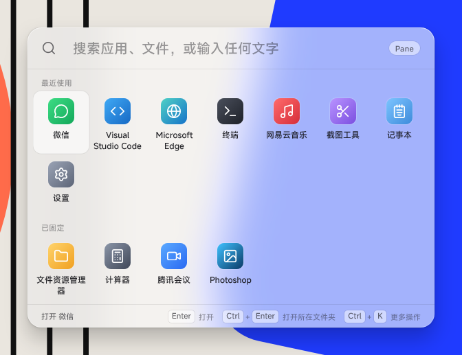
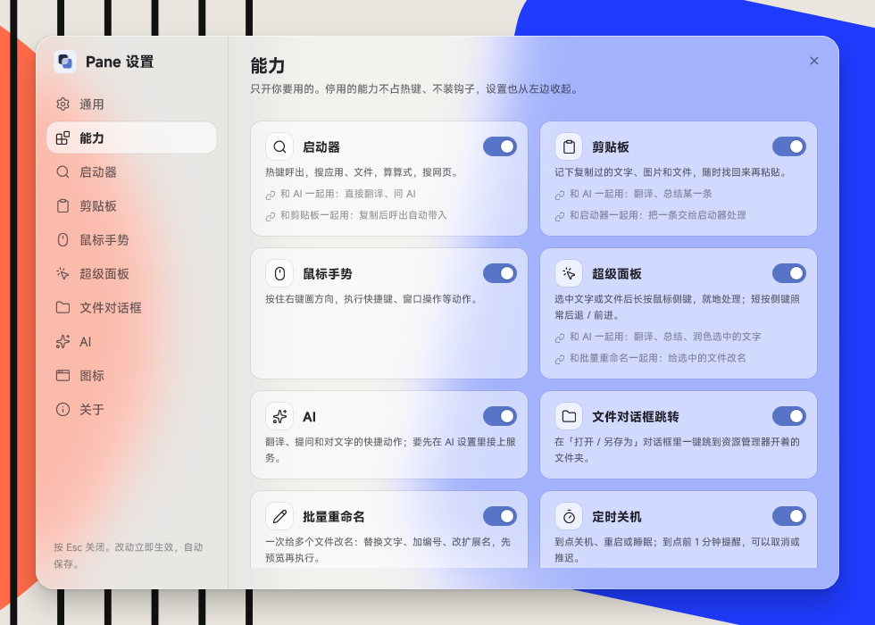
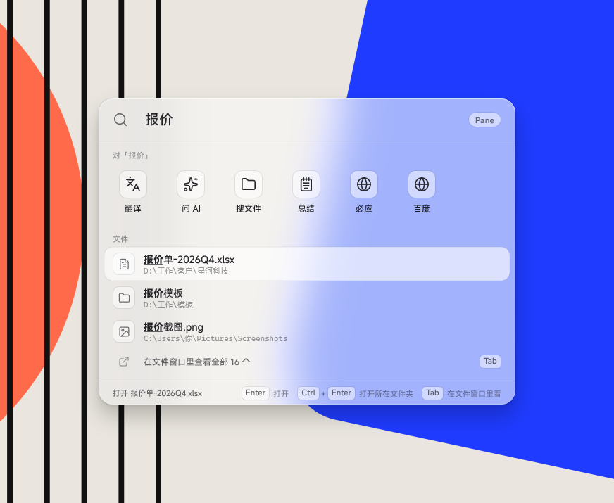
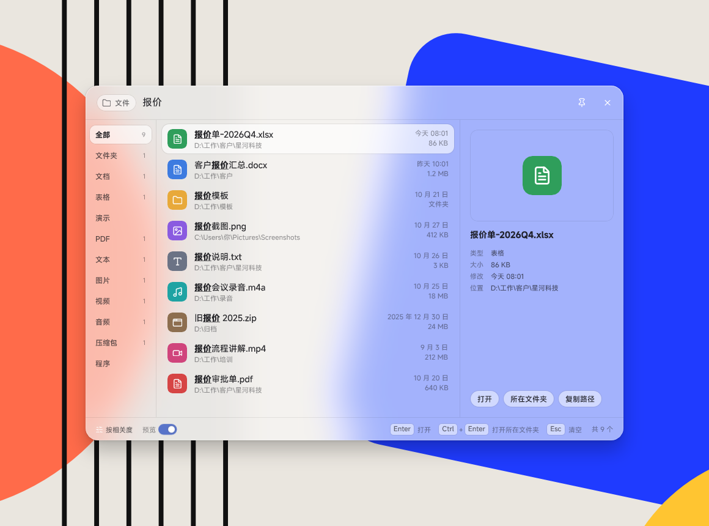
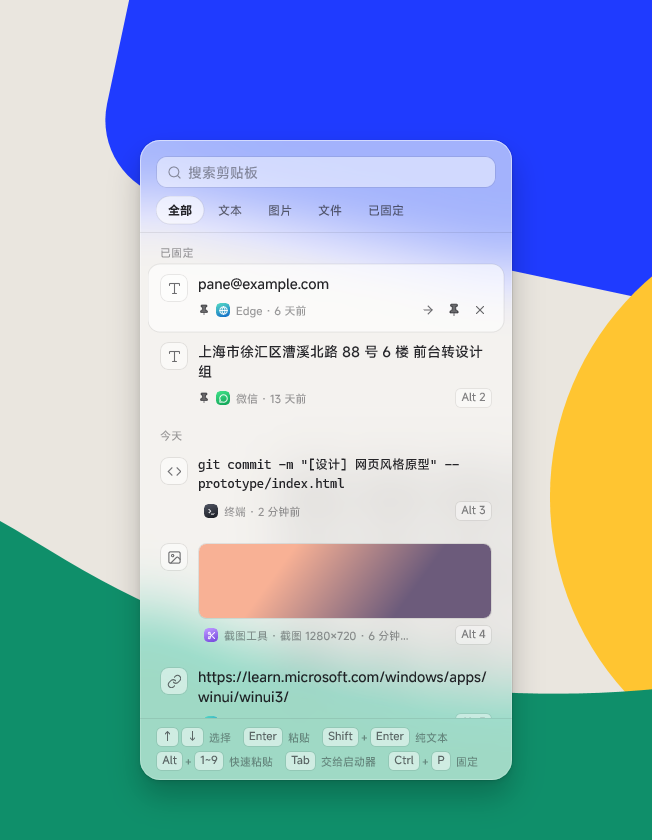
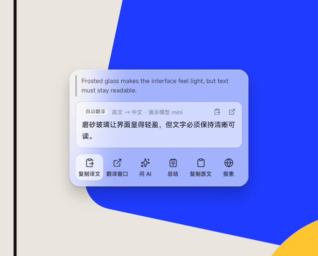

<p align="center">
<picture>
  <source media="(prefers-color-scheme: dark)" srcset="docs/images/banner-dark.png">
  
</picture>
</p>

<p align="center">
  <a href="https://github.com/LBEILC/Pane/releases/latest"></a>
  
  
  <a href="LICENSE"></a>
  <a href="https://qm.qq.com/q/x1BlWfEO2e"></a>
</p>

<p align="center">
  <a href="https://github.com/LBEILC/Pane/releases/latest"><b>下载最新版</b></a> ·
  <a href="#安装">安装说明</a> ·
  <a href="#隐私">隐私</a> ·
  <a href="#反馈与交流">交流群</a> ·
  <a href="#从源码构建">从源码构建</a>
</p>

一个常驻的小程序，把「快速启动 / 搜索」「剪贴板历史」「鼠标手势」这几类工具合在一起，界面是半透明的磨砂玻璃：大圆角、细高光边、柔和阴影，跟着系统深浅色走。只做用得到的功能，常驻占用尽量低。

<p align="center">
<picture>
  <source media="(prefers-color-scheme: dark)" srcset="docs/images/launcher-dark.png">
  
</picture>
</p>

## 功能一览

每一块都是一项「能力」，在 **设置 → 能力** 里单独开关：停用的能力不占热键、不装钩子，它的设置也从左边收起。

| | 能力 | 做什么 | 默认怎么用 |
|:-:|---|---|---|
|  | [启动器](#启动器) | 搜应用和文件、算算式、跑系统命令、搜网页，对任意文字直接翻译或问 AI | `Alt+空格` |
|  | [剪贴板](#剪贴板) | 记下复制过的文字、图片和文件，随时找回来再粘贴 | `Alt+V`，可替换 `Win+V` |
|  | [鼠标手势](#鼠标手势) | 按住右键画方向，执行快捷键、窗口操作等动作 | 按住右键拖动 |
|  | [超级面板](#超级面板) | 选中文字或文件后就地处理：翻译、总结、润色、改名…… | 选中后长按鼠标后退侧键 |
|  | [AI](#ai) | 翻译、提问和对文字的快捷动作；接自己的 API 或 ChatGPT 账号 | 在启动器、超级面板里用 |
|  | [文件对话框跳转](#文件对话框跳转) | 「打开 / 另存为」对话框里一键跳到资源管理器开着的文件夹 | `Ctrl+G` |
|  | [批量重命名](#批量重命名) | 一次给多个文件改名：替换文字、加编号、改扩展名，先预览再执行 | 启动器「重命名」或超级面板 |
|  | [定时关机](#定时关机) | 到点关机、重启或睡眠，到点前 1 分钟提醒 | 启动器里输入「30分钟后关机」 |

<picture>
  <source media="(prefers-color-scheme: dark)" srcset="docs/images/modules-dark.png">
  
</picture>

## 启动器

默认 `Alt+空格` 呼出，可以在 **设置 → 启动器** 换成别的键，包括双击 `Ctrl` 这类按法。

<picture>
  <source media="(prefers-color-scheme: dark)" srcset="docs/images/launcher-search-dark.png">
  
</picture>

- **搜应用**：支持拼音和首字母（`wx` → 微信）；同一个程序的多个入口只显示一条。不在开始菜单里的绿色 / 便携软件，可以拖进设置、指定文件夹扫描，或者用 Pane 打开过一次就自动记住。
- **首页**：最近使用和你固定的应用；选中应用按 `Ctrl+K`（或右键）可以固定到首页、打开所在文件夹、以管理员身份运行等。
- **其他结果**：算式、系统命令（锁屏、睡眠、设备管理器、控制面板各项……）、常用文件和文件夹、网页搜索关键字直达。
- **对任何文字**都有一排动作：翻译、问 AI、搜文件、AI 预设动作、网页搜索；按住 `Alt` 显示序号，`Alt+数字` 直接触发。
- 复制后几秒内呼出，刚复制的内容自动作为附件带进来，可以直接交给 AI 或改名。
- 底部一行写明选中项按 `Enter` / `Tab` / `Ctrl+Enter` 各做什么；宽度和显示几行可以调。

**三个窗口**：从启动器按 `Tab` 展开，失去焦点不关。

<picture>
  <source media="(prefers-color-scheme: dark)" srcset="docs/images/files-dark.png">
  
</picture>

- **文件**：[Everything](https://www.voidtools.com/) 驱动的文件搜索，按类型分类、按修改时间排序、预览、拖出文件。
- **翻译**：边打边翻，中文自动译成英文，其余译成你设定的语言。
- **AI 对话**：多轮对话，可以换模型；只保留到关掉窗口为止。

## 剪贴板

默认 `Alt+V`，可以在设置里一键替换系统的 `Win+V`（停用时会先恢复系统设置）。

<picture>
  <source media="(prefers-color-scheme: dark)" srcset="docs/images/clipboard-dark.png">
  
</picture>

- 记录文字、图片、文件列表；搜索、固定、按类型筛选；`Shift+Enter` 粘贴为纯文本。
- 呼出时不抢走当前窗口的焦点，粘贴回原来的输入框。
- 条目可以直接交给 AI（翻译、总结）或交给启动器处理。
- 识别密码管理器等程序的「不进历史」标记，也可以排除指定程序。

## 鼠标手势

- 按住右键画八方向手势，可以连成多段；按住右键时滚滚轮、点左键 / 中键也能触发动作（例如按住右键滚轮切换标签页）。
- 动作：发快捷键、发按键序列、网页搜索选中文字、运行命令、窗口操作、音量、任务切换、打开程序或网址。
- 按程序设置：全局规则之外，可以给某个程序单独加规则或禁用。
- 右键没移动就松开，仍然是一次普通的右键。暂停 / 恢复手势：`Ctrl+Alt+Shift+W`。
- 能一键导入 WGestures 的配置。

装好后自带这一套，可以在 **设置 → 鼠标手势** 里改、删、加：

| 手势（按住右键） | 动作 | 快捷键 |
|---|---|---|
| ← | 后退 | `Alt+←` |
| → | 前进 | `Alt+→` |
| ↑ | 回到顶部 | `Home` |
| ↓ | 到底部 | `End` |
| ↓ → | 关闭标签页 | `Ctrl+W` |
| ← ↑ | 重新打开关掉的标签页 | `Ctrl+Shift+T` |
| 滚轮向上 / 向下（不画方向） | 切换到上一个 / 下一个标签页 | `Ctrl+Shift+Tab` / `Ctrl+Tab` |

## 超级面板

选中文字（或在资源管理器里选中文件）后，**长按**鼠标后退侧键。

<picture>
  <source media="(prefers-color-scheme: dark)" srcset="docs/images/super-dark.png">
  
</picture>

- 文字：翻译、总结、润色、解释、网页搜索、复制，结果可以直接替换回原文；可选选中外文时自动翻译。
- 文件：批量重命名等文件动作。
- **短按**侧键照常是后退 / 前进，不影响原来的用法；全屏程序里不触发。

## AI

可选，不配置也不影响其他功能。在 **设置 → AI** 里二选一：

- **第三方 API**：内置 DeepSeek、通义千问、智谱 GLM、OpenAI，填 Key 就能用；也可以添加任意多个自定义服务商，自己起名字、填地址，接口格式选 OpenAI 兼容或 Anthropic。每家各记各的模型和 Key，来回切换不用重填。
- **ChatGPT 账号**：用账号登录，不需要 API Key。

可以设置代理和思考程度。只在你主动触发时才把那一段文字发出去；Key 和登录信息用 Windows 数据保护加密保存在本机。

## 文件对话框跳转

在任何程序的「打开 / 另存为」对话框里按 `Ctrl+G`，直接跳到资源管理器当前开着的文件夹；`Ctrl+Shift+G` 弹出菜单，从开着的和最近用过的文件夹里选。也可以设成对话框一打开就自动跳过去。

## 批量重命名

从启动器输入「重命名」、对复制带进来的文件用附件动作，或在超级面板里选中文件后打开。替换文字、加编号、改大小写和扩展名等规则可以叠加，改动的部分在预览里标出来，确认后才执行；常用的规则组合可以存成预设。

## 定时关机

在启动器里直接说：`30分钟后关机`、`1.5小时后重启`、`23:30 睡眠`（也认 `gj` / `shutdown` 这类写法）。到点前 1 分钟提醒，可以取消或推迟；托盘菜单里也能看到和取消。

## 安装

1. 到 [Releases](https://github.com/LBEILC/Pane/releases/latest) 下载最新的 `Pane-Setup-<版本>.exe`。
2. 运行。安装包没有代码签名，Windows SmartScreen 可能会拦：点「更多信息」→「仍要运行」。
3. 默认装到 `%LOCALAPPDATA%\Programs\Pane`，只装给当前用户，不需要管理员权限。设置、剪贴板历史、手势配置在 `%APPDATA%\Pane`。

有新版本时 Pane 会在后台下载好，在 **设置 → 关于** 里能看到这一版改了什么，点一下重启更新；也可以设成下次启动时自动安装，或者关掉自动更新。

**可选的依赖**

- 文件搜索需要 [Everything](https://www.voidtools.com/) 1.4 或更新的版本在运行。
- 界面字体默认用 [MiSans](https://hyperos.mi.com/font)（不随 Pane 分发），没装时用微软雅黑；也可以在 **设置 → 通用 → 字体** 里换成本机任意字体。
- AI 功能需要你自己的 API Key 或 ChatGPT 账号。

**从其他工具迁移**

- **WGestures**：**设置 → 鼠标手势 → 从 WGestures 导入**，先预览再整套替换。两者同时运行时，Pane 的手势会先不启用。
- **uTools 等也用 `Alt+空格` 的工具**：在那边改掉快捷键，或者在 **设置 → 启动器** 里给 Pane 换一个。
- 用不到的能力直接在 **设置 → 能力** 里关掉，和别的工具互不打架。

## 隐私

- 所有数据都在本机：没有账号、没有云同步、不收集统计。
- 剪贴板历史只存在本机；带「不进历史」标记的内容不记录。
- 联网只有三种情况：你用 AI 功能时访问你配置的服务；检查更新时访问 GitHub；你用网页搜索时打开浏览器。

截图里的文件、剪贴板内容都是演示数据。

## 反馈与交流

- **QQ 群「Pane官方交流群」：[1131911368](https://qm.qq.com/q/x1BlWfEO2e)**（点链接直接加群）。用的时候遇到问题、有想法，或者对 Pane 感兴趣，都欢迎加群交流。
- 需要跟进的问题和功能建议，也可以提到 [Issues](https://github.com/LBEILC/Pane/issues)，方便记录和回复。

## 从源码构建

需要 Windows 11、.NET 10 SDK、Visual Studio 2022（含「使用 C++ 的桌面开发」工作负载，用来编译原生钩子层）。

```powershell
# 开发版（JIT），输出到 src/Pane.App/bin/jit
powershell -ExecutionPolicy Bypass -File src/Pane.App/scripts/build.ps1 -Mode jit

# 安装包（NativeAOT），输出到 dist/
powershell -ExecutionPolicy Bypass -File scripts/package.ps1
```

代码结构：`src/Pane.App`（WinUI 3 界面和服务，每块能力是一个模块）、`src/Pane.Gestures`（手势识别）、`src/Pane.Native`（C++ 鼠标钩子、选区读取、Everything 查询）、`src/Pane.Setup`（安装程序外壳）、`tests/`。

## 许可证

[GPL-3.0](LICENSE)，附加一条第 7 节许可：允许和 Windows App SDK、VC++ 运行库、.NET 运行库、WebView2 SDK 这些微软组件一起分发（见 [LICENSE-EXCEPTION.md](LICENSE-EXCEPTION.md)）。用到的第三方组件和它们的许可见 [THIRD_PARTY_NOTICES.md](THIRD_PARTY_NOTICES.md)；图标来自 [Lucide](https://lucide.dev)（ISC）。

界面风格参考了 MyDockFinder；功能上参考了 uTools、WGestures 和 TieZ 的交互（只参考交互，没有使用它们的代码）。
